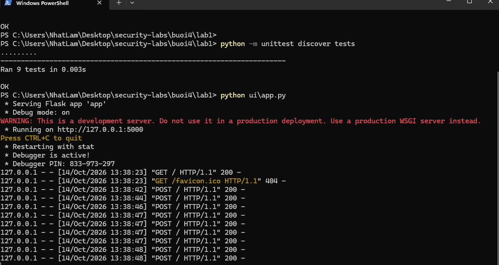
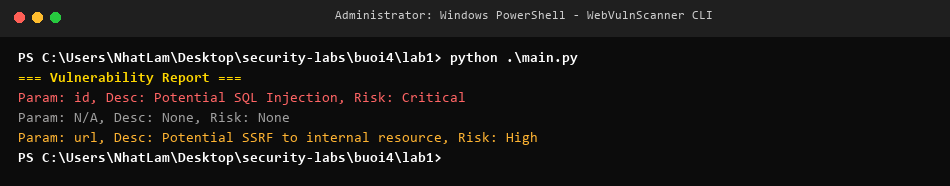
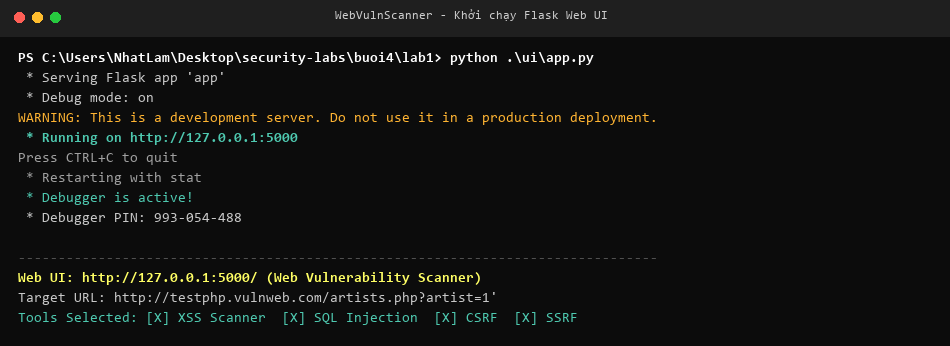
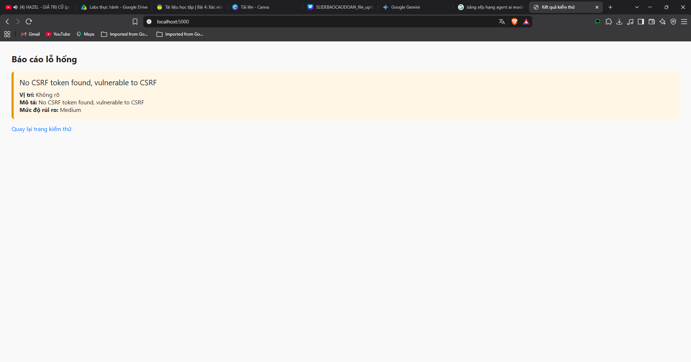
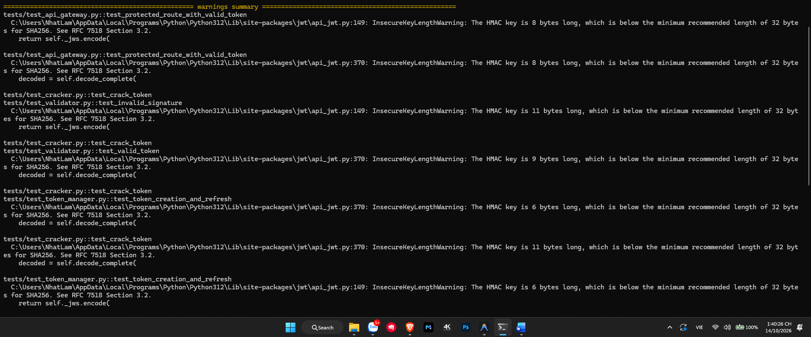
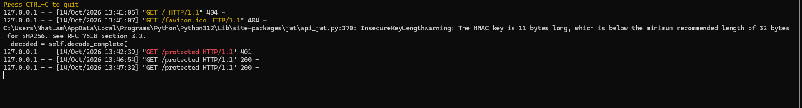
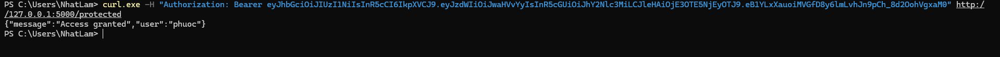

# Báo cáo thực hành Buổi 4: Bảo mật Web App và API

- **Sinh viên thực hiện**: Nguyễn Nhật Lâm
- **Môn học**: Lập trình an toàn (Bảo mật ứng dụng)
- **Repository**: [https://github.com/newiexk-cyber/security-labs](https://github.com/newiexk-cyber/security-labs)

Báo cáo tổng hợp kết quả triển khai và kiểm thử các bài thực hành Buổi 4:
- **Lab 1**: Xây dựng công cụ quét lỗ hổng ứng dụng Web (**WebVulnScanner**).
- **Lab 2**: Bộ công cụ kiểm thử bảo mật JWT & OAuth 2.0 (**JWTSecure**).

---

## 1. Cấu trúc thư mục Buổi 4

```text
buoi4/
├── README.md                   # Báo cáo tổng hợp Buổi 4
├── images/                     # Ảnh chụp kết quả kiểm thử thực tế
│   ├── lab1_step1_unittest.png
│   ├── lab1_step2_cli_main.png
│   ├── lab1_step3_web_form.png
│   ├── lab1_step4_web_results.png
│   ├── lab2_step1_pytest.png
│   ├── lab2_step2_main_tokens.png
│   └── lab2_step3_curl_verify.png
├── lab1/                       # Lab 1: Web Vulnerability Scanner
│   ├── README.md               # Hướng dẫn chi tiết Lab 1
│   ├── report/                 # Tổng hợp báo cáo lỗ hổng
│   ├── scanners/               # Các module kiểm thử (XSS, SQLi, CSRF, SSRF)
│   ├── tests/                  # Bộ unit tests cho các scanner
│   ├── ui/                     # Giao diện Web Flask + HTML Templates
│   ├── main.py                 # Demo CLI
│   └── requirements.txt
└── lab2/                       # Lab 2: JWTSecure Toolkit
    ├── README.md               # Hướng dẫn chi tiết Lab 2
    ├── api_gateway/            # Cổng API Gateway xác thực Bearer Token
    ├── jwt_cracker/            # Tấn công brute-force từ điển khóa JWT
    ├── jwt_validator/          # Xác thực chữ ký và thời hạn token
    ├── oauth_client/           # Mô phỏng Authorization Code Flow
    ├── token_manager/          # Quản lý phát hành Access/Refresh Tokens
    ├── tests/                  # Bộ unit tests cho JWT & OAuth
    ├── main.py                 # Khởi chạy demo Gateway và sinh token
    ├── pytest.ini
    └── requirements.txt
```

---

## 2. Chi tiết thực hiện Lab 1: Web Vulnerability Scanner

### 2.1. Kiểm thử tự động các module quét (Unit Tests)
Thực thi kiểm thử tự động toàn diện cho 4 module quét (XSS, SQL Injection, CSRF, SSRF) và module xuất báo cáo ReportGenerator:



### 2.2. Kiểm thử công cụ qua dòng lệnh (CLI)
Chạy script `main.py` quét mẫu và trích xuất danh sách các lỗ hổng tìm được:



### 2.3. Kiểm thử qua giao diện Web (Flask App)
Khởi động ứng dụng Flask Web UI phục vụ tương tác trực quan:



Kết quả hiển thị báo cáo lỗ hổng phân loại trực quan theo mức độ rủi ro (Critical, High, Medium):



---

## 3. Chi tiết thực hiện Lab 2: JWTSecure Toolkit

### 3.1. Kiểm thử tự động bộ công cụ JWT (Pytest)
Thực thi toàn bộ 7 test case cho API Gateway, Brute-force Cracker, OAuth Client, Token Manager và Validator:



### 3.2. Quản lý vòng đời Token & Khởi chạy API Gateway
Khởi chạy `main.py` để sinh cặp Access Token (thời hạn 15 phút) và Refresh Token (thời hạn 24 giờ), đồng thời kích hoạt cổng API Gateway bảo vệ endpoint `/protected`:



### 3.3. Xác thực người dùng qua HTTP Authorization Header
Sử dụng `curl` gửi yêu cầu kèm Access Token để xác thực truy cập tài nguyên bảo mật:
- Khi truyền đúng token: Server giải mã thành công và trả về `{"message": "Access granted", "user": "phuoc"}`.
- Khi truyền token sai hoặc giả mạo: Server từ chối truy cập với mã trạng thái HTTP 401 `{"message": "Access denied"}`.



---

## 4. Kết luận và Đánh giá an toàn

1. **Bảo mật ứng dụng Web (OWASP Top 10)**:
   - Các cơ chế quét tự động giúp phát hiện sớm các nguy cơ nghiêm trọng như thiếu CSRF token, tham số chưa được lọc dẫn tới SQLi, SSRF và Reflected XSS.
   - Việc áp dụng Input Validation và Output Encoding kết hợp với Content Security Policy (CSP) là biện pháp cốt lõi để triệt tiêu các lỗ hổng này.
2. **Bảo mật Token và Ủy quyền API (JWT & OAuth 2.0)**:
   - Khóa bí mật ký JWT đối xứng (`HS256`) bắt buộc phải có độ dài đủ lớn (khuyến nghị từ 256-bit trở lên) để chống lại các kỹ thuật tấn công dò từ điển (Dictionary/Brute-force Attack).
   - Tách biệt rõ ràng vai trò của Access Token (sống ngắn) và Refresh Token (bảo mật chặt chẽ ở storage an toàn) giúp giảm thiểu tối đa rủi ro khi token bị lộ lọt trên đường truyền.

