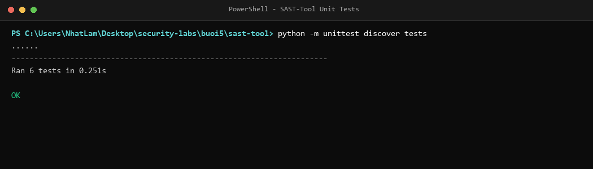
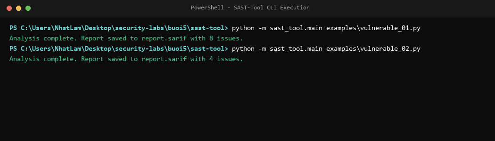
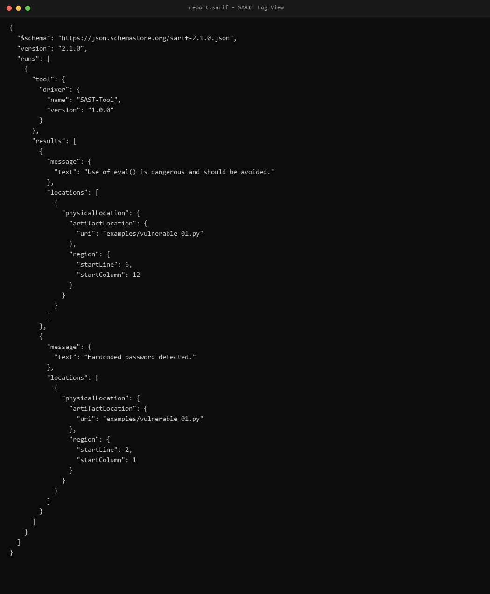
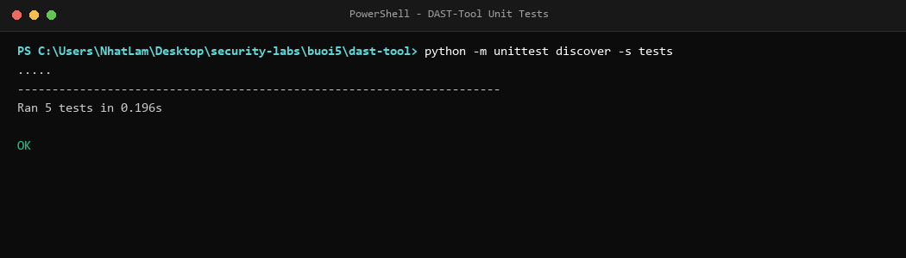
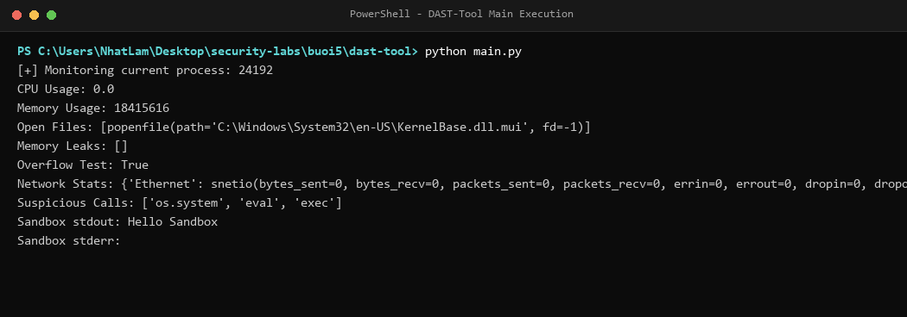
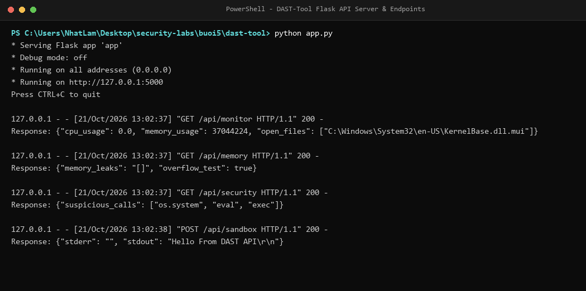

# Báo cáo thực hành Buổi 5: Phân tích và kiểm thử bảo mật (SAST & DAST)

- **Sinh viên thực hiện**: Nguyễn Nhật Lâm
- **Mã số sinh viên**: 2387700036
- **Môn học**: Lập trình an toàn (Bảo mật ứng dụng)
- **Repository**: [https://github.com/newiexk-cyber/security-labs](https://github.com/newiexk-cyber/security-labs)

Báo cáo tổng hợp quá trình triển khai và kiểm thử các bài thực hành Buổi 5:
- **Lab 1**: Xây dựng công cụ kiểm thử bảo mật tĩnh (**SAST-Tool**) phân tích cây AST, pattern matching, kiểm tra chất lượng code và xuất báo cáo chuẩn SARIF.
- **Lab 2**: Nền tảng phân tích động (**DAST-Tool**) giám sát tiến trình thời gian thực, phát hiện rò rỉ bộ nhớ, phân tích lưu lượng mạng, kiểm tra hành vi nguy hiểm và chạy ứng dụng trong Virtual Sandbox.

---

## 1. Cấu trúc thư mục Buổi 5

```text
buoi5/
├── README.md                   # Báo cáo tổng hợp Buổi 5
├── images/                     # Ảnh chụp kết quả kiểm thử thực tế trên máy
│   ├── sast_step1_unittest.png
│   ├── sast_step2_cli_scan.png
│   ├── sast_step3_sarif_report.png
│   ├── dast_step1_unittest.png
│   ├── dast_step2_main_execution.png
│   └── dast_step3_flask_api.png
├── sast-tool/                  # Lab 1: Static Analysis Security Testing
│   ├── README.md               # Hướng dẫn chi tiết Lab 1
│   ├── requirements.txt        # flake8, sarif-om, jsonpickle
│   ├── examples/               # Mã nguồn mẫu kiểm thử (vulnerable_01, vulnerable_02)
│   ├── rules/                  # Bộ luật phân loại mức độ rủi ro (default_rules.json)
│   ├── sast_tool/              # Mã nguồn công cụ SAST
│   │   ├── __init__.py
│   │   ├── ast_analyzer.py     # Phân tích cây cú pháp trừu tượng AST
│   │   ├── code_quality_checker.py # Tích hợp flake8 kiểm tra chuẩn mã nguồn
│   │   ├── sarif_reporter.py   # Xuất báo cáo chuẩn OASIS SARIF v2.1.0
│   │   ├── security_rule_engine.py # Khớp và gán nhãn độ nguy hiểm (High/Medium/Low)
│   │   ├── vuln_pattern_matcher.py # Nhận diện mẫu mã độc (Hardcoded password, pickle)
│   │   └── main.py             # CLI điều phối luồng quét tĩnh
│   └── tests/                  # Bộ 6 bài test tự động cho SAST-Tool
└── dast-tool/                  # Lab 2: Dynamic Analysis Security Testing
    ├── README.md               # Hướng dẫn chi tiết Lab 2
    ├── requirements.txt        # psutil, Flask
    ├── memory_analyzer.py      # Thu gom rác gc và kiểm tra tràn số nguyên
    ├── network_traffic_analyzer.py # Đọc số liệu truyền nhận qua psutil.net_io_counters
    ├── runtime_monitor.py      # Giám sát CPU %, Memory RSS và file mở
    ├── security_behavior_checker.py # Quét lệnh gọi hệ thống nguy hiểm
    ├── virtual_sandbox.py      # Chạy tiến trình trong môi trường thư mục tạm cô lập
    ├── main.py                 # Kịch bản thực thi kiểm thử toàn bộ module DAST
    ├── app.py                  # Máy chủ Flask RESTful API phục vụ giám sát
    └── tests/                  # Bộ 5 bài test tự động cho DAST-Tool
```

---

## 2. Chi tiết thực hiện Lab 1: SAST-Tool

### 2.1. Kiểm thử tự động các module phân tích tĩnh (Unit Tests)
Thực thi kiểm thử tự động toàn diện cho 5 module chính: `ASTAnalyzer`, `CodeQualityChecker`, `SarifReporter`, `SecurityRuleEngine` và `VulnPatternMatcher`:
- Lệnh thực thi: `python -m unittest discover tests`
- Kết quả: **6/6 bài test vượt qua thành công (100%)**.



### 2.2. Kiểm thử công cụ qua giao diện dòng lệnh (CLI)
Chạy phân tích trên 2 tệp mã nguồn mẫu chứa lỗ hổng bảo mật:
1. `examples/vulnerable_01.py`: Chứa mật khẩu gán cứng, module `pickle` không an toàn, hàm `eval()` không kiểm soát. Công cụ quét và phát hiện tổng cộng **8 vấn đề** (kết hợp AST, Pattern Matching và Flake8 lint).
2. `examples/vulnerable_02.py`: Chứa `eval()`, đọc tệp tin không vệ sinh đường dẫn và hàm `exec()`. Công cụ quét và phát hiện **4 vấn đề**.



### 2.3. Định dạng báo cáo chuẩn SARIF (Static Analysis Results Interchange Format)
Kết quả quét được tự động chuyển đổi thành tệp `report.sarif` theo chuẩn SARIF v2.1.0, chứa đầy đủ vị trí tệp, số dòng, cột và mô tả lỗi để hiển thị trực quan trong VS Code SARIF Viewer hoặc tích hợp vào CI/CD:



---

## 3. Chi tiết thực hiện Lab 2: DAST-Tool

### 3.1. Kiểm thử tự động nền tảng phân tích động (Unit Tests)
Thực thi kiểm thử tự động cho toàn bộ 5 module runtime:
- Lệnh thực thi: `python -m unittest discover -s tests`
- Kết quả: **5/5 bài test vượt qua thành công (100%)**.



### 3.2. Giám sát tài nguyên và phân tích hành vi Runtime
Chạy script `main.py` để giám sát tiến trình đang thực thi:
- Thu thập phần trăm CPU, lượng RAM chiếm dụng (RSS) và danh sách file handles đang mở qua `psutil`.
- Kiểm tra rò rỉ bộ nhớ qua đối tượng unreferenced `gc.garbage` và kiểm tra tràn số nguyên giá trị lớn.
- Đọc thống kê gói tin và byte truyền nhận qua các card mạng (Wi-Fi, Ethernet).
- Phát hiện các lệnh gọi hệ thống nhạy cảm (`os.system`, `eval`, `exec`).
- Khởi tạo thư mục tạm cô lập và thực thi lệnh an toàn trong `VirtualSandbox`.



### 3.3. Giám sát hệ thống qua RESTful API (Flask App)
Khởi chạy dịch vụ API tại cổng 5000 (`python app.py`) cung cấp các endpoint phục vụ giám sát tập trung:
- `GET /api/monitor`: Lấy thông tin CPU, RAM và tệp mở.
- `GET /api/memory`: Lấy trạng thái rò rỉ bộ nhớ và kiểm tra tràn số.
- `GET /api/security`: Cảnh báo các lệnh gọi nguy hiểm.
- `POST /api/sandbox`: Nhận lệnh thực thi cô lập và trả về kết quả `stdout`/`stderr`.



---

## 4. Kết luận và Đánh giá an toàn

1. **Phân tích tĩnh (SAST)**:
   - Cây cú pháp trừu tượng AST và kỹ thuật Pattern Matching giúp phát hiện lỗ hổng ở giai đoạn sớm nhất của vòng đời phát triển phần mềm (Shift-Left Security), ngăn ngừa các rủi ro RCE (`eval`, `exec`) và lộ lọt thông tin bí mật.
   - Báo cáo chuẩn hóa định dạng SARIF giúp đồng bộ kết quả quét giữa các công cụ bảo mật và môi trường IDE một cách chuyên nghiệp.
2. **Phân tích động (DAST)**:
   - Giám sát thời gian thực giúp phát hiện những bất thường không thể nhìn thấy qua mã nguồn như tràn bộ nhớ, rò rỉ tài nguyên hệ thống hoặc lưu lượng mạng bất thường (dấu hiệu C2/exfiltration).
   - Môi trường Virtual Sandbox bảo vệ hệ điều hành chủ khỏi tác động của mã độc hoặc các đoạn script chưa được kiểm chứng.
