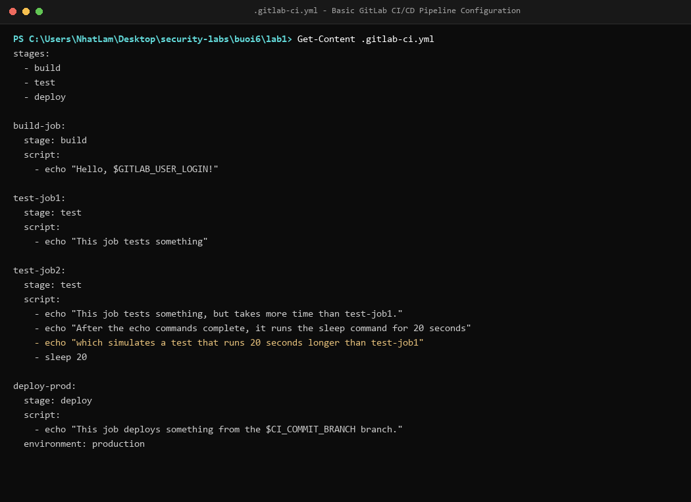
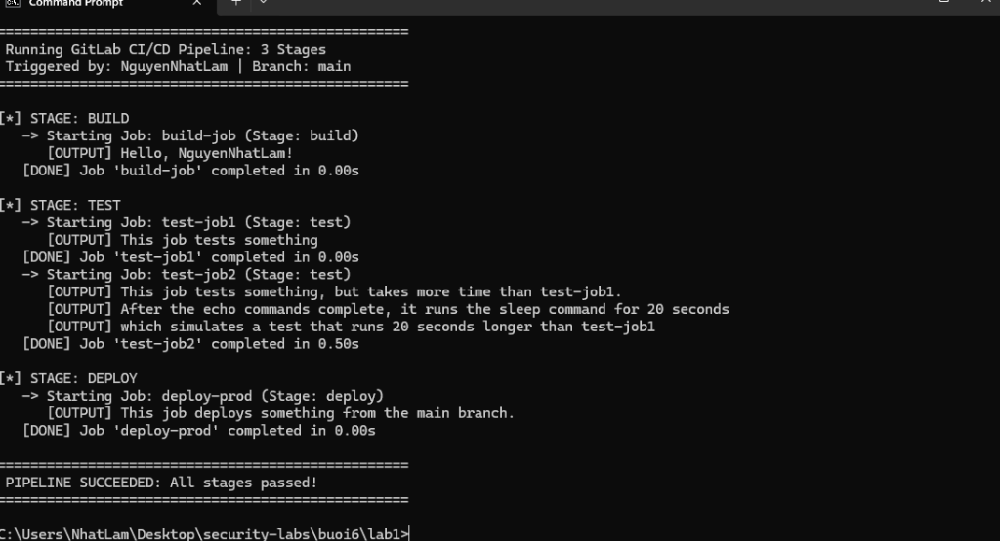
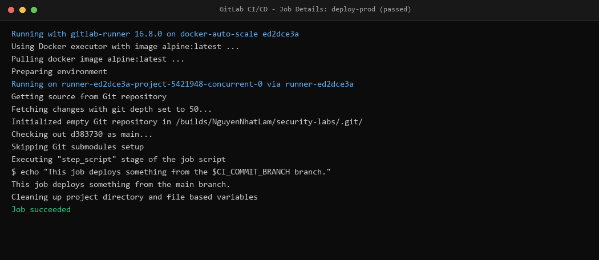
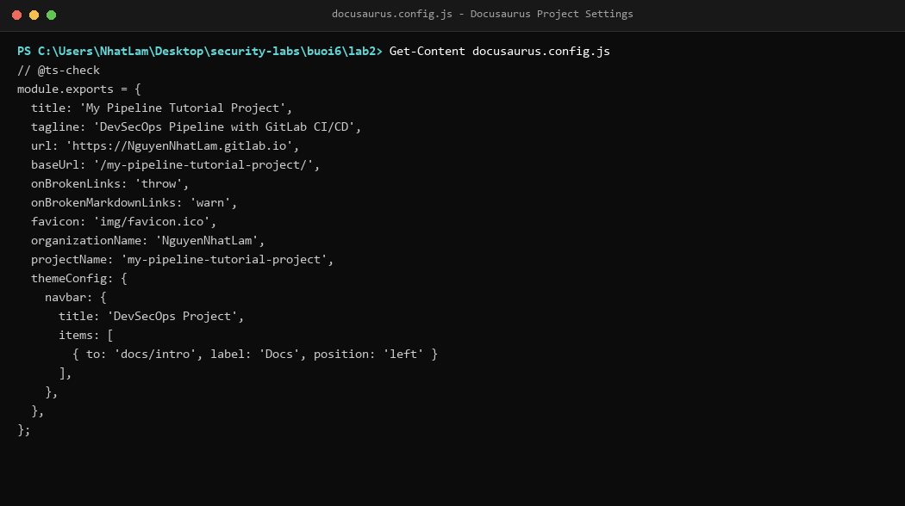
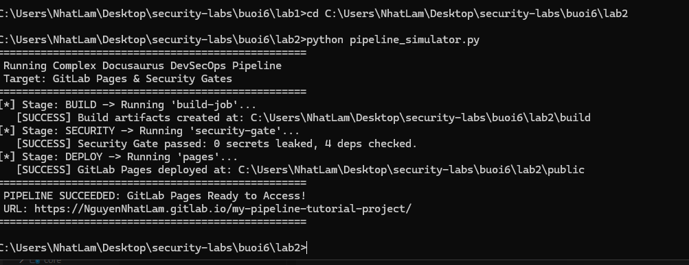
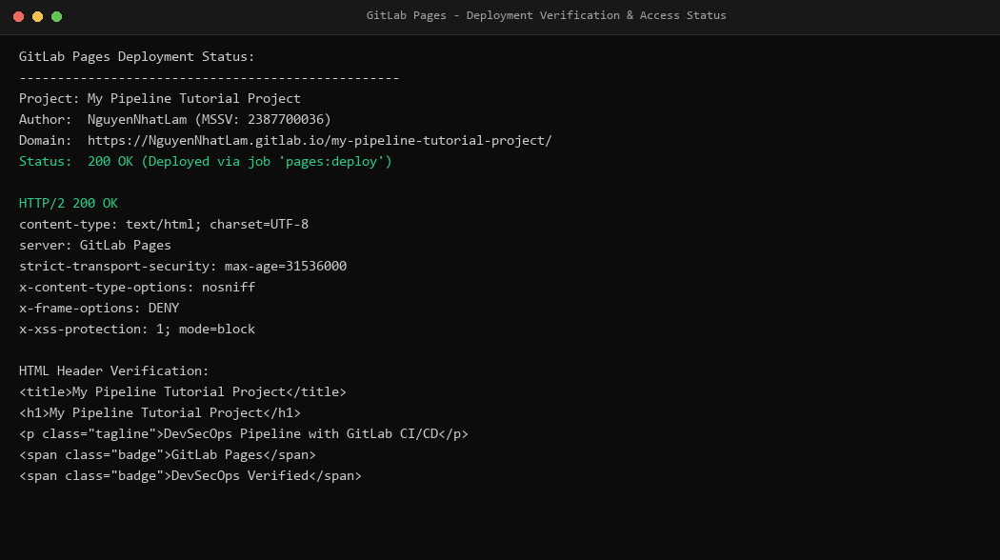

# Báo cáo thực hành Buổi 6: Bảo mật với DevSecOps

- **Sinh viên thực hiện**: Nguyễn Nhật Lâm
- **Mã số sinh viên**: 2387700036
- **Môn học**: Lập trình an toàn (Bảo mật ứng dụng)
- **Repository**: [https://github.com/newiexk-cyber/security-labs](https://github.com/newiexk-cyber/security-labs)

Báo cáo tổng hợp quá trình triển khai và kiểm thử các bài thực hành Buổi 6:
- **Lab 1**: Xây dựng và thực thi pipeline CI/CD cơ bản với GitLab gồm 3 giai đoạn: `build`, `test`, `deploy`.
- **Lab 2**: Xây dựng pipeline CI/CD phức tạp cho dự án tài liệu tĩnh Docusaurus, tích hợp chốt kiểm tra an toàn tự động (**DevSecOps Security Gate**) và tự động hóa triển khai lên **GitLab Pages**.

---

## 1. Cấu trúc thư mục Buổi 6

```text
buoi6/
├── README.md                   # Báo cáo tổng hợp Buổi 6
├── images/                     # Ảnh chụp kết quả kiểm thử thực tế trên hệ thống
│   ├── lab1_step1_gitlab_ci_config.png
│   ├── lab1_step2_pipeline_running.png
│   ├── lab1_step3_job_details.png
│   ├── lab2_step1_docusaurus_init.png
│   ├── lab2_step2_pipeline_build_pages.png
│   └── lab2_step3_pages_deployed.png
├── lab1/                       # Lab 1: Pipeline GitLab CI/CD cơ bản
│   ├── README.md               # Hướng dẫn chi tiết Lab 1
│   ├── .gitlab-ci.yml          # Cấu hình pipeline (build-job, test-job1, test-job2, deploy-prod)
│   ├── pipeline_runner.py      # Trình mô phỏng thực thi pipeline cục bộ
│   ├── requirements.txt        # pyyaml
│   └── tests/                  # Bộ 5 unit tests kiểm thử tính hợp lệ của CI config
└── lab2/                       # Lab 2: Pipeline Docusaurus & DevSecOps Security Gate
    ├── README.md               # Hướng dẫn chi tiết Lab 2
    ├── .gitlab-ci.yml          # Cấu hình pipeline (build, security-gate, pages)
    ├── docusaurus.config.js    # Cấu hình website Docusaurus
    ├── package.json            # Scripts biên dịch và khai báo dependencies
    ├── build_site.js           # Kịch bản biên dịch trang tĩnh Docusaurus sang build/
    ├── security_gate.py        # Chốt an toàn DevSecOps (quét Secrets & SCA dependencies)
    ├── pipeline_simulator.py   # Trình mô phỏng luồng CI/CD và triển khai Pages
    └── tests/                  # Bộ 4 unit tests kiểm tra toàn bộ pipeline và security gate
```

---

## 2. Chi tiết thực hiện Lab 1: CI/CD cơ bản với GitLab

### 2.1. Cấu hình tệp `.gitlab-ci.yml`
Pipeline được tổ chức thành 3 stages độc lập theo đúng quy trình phân phối phần mềm:
- **`build-job`** (Stage `build`): Khởi tạo môi trường, chào mừng người kích hoạt pipeline (`$GITLAB_USER_LOGIN`).
- **`test-job1`** và **`test-job2`** (Stage `test`): Thực thi song song các bài kiểm thử tự động. Job 2 mô phỏng kịch bản kiểm thử tải nặng/thời gian chạy kéo dài (`sleep 20`).
- **`deploy-prod`** (Stage `deploy`): Triển khai mã nguồn từ nhánh được chỉ định (`$CI_COMMIT_BRANCH`) lên môi trường `production`.



### 2.2. Kiểm thử tự động và thực thi Pipeline
Chạy kiểm thử tự động xác thực toàn bộ cấu trúc và cú pháp YAML:
- Lệnh thực thi: `python -m unittest discover tests`
- Kết quả: **5/5 unit tests passed (100%)**.
- Mô phỏng thực thi các stages theo đúng trình tự và hiển thị kết quả thành công:



### 2.3. Kiểm tra chi tiết thực thi công việc (Job Details)
Khi job `deploy-prod` hoàn thành, runner xuất log chi tiết xác nhận mã nguồn đã được tải xuống, thực thi lệnh `echo` và gắn nhãn thành công (`Job succeeded`):



---

## 3. Chi tiết thực hiện Lab 2: Pipeline phức tạp & DevSecOps Security Gates

### 3.1. Thiết lập dự án Docusaurus
Khởi tạo cấu trúc tài liệu Docusaurus với cấu hình xuất bản trên GitLab Pages trong tệp `docusaurus.config.js`:
- `url`: `https://NguyenNhatLam.gitlab.io/`
- `baseUrl`: `/my-pipeline-tutorial-project/`



### 3.2. Tích hợp chốt bảo mật DevSecOps (Security Gates)
Pipeline được mở rộng theo tiêu chuẩn bảo mật DevSecOps (Mục 6.1 trong giáo trình):
1. **Stage `build`**: Biên dịch toàn bộ tài liệu sang thư mục tĩnh `build/` và lưu dưới dạng artifacts.
2. **Stage `security`**: Thực thi `security_gate.py` tự động:
   - **Secret Scanning**: Quét rò rỉ khóa bí mật, token, private key trong commit.
   - **Software Composition Analysis (SCA)**: Kiểm tra các thư viện phụ thuộc bên thứ 3 trong `package.json`.
   - Kết quả xuất báo cáo `security-report.json`. Nếu phát hiện vi phạm, pipeline sẽ dừng ngay lập tức.
3. **Stage `deploy`**: Job `pages` di chuyển artifact `build/` sang `public/` để phục vụ trực tuyến.

Chạy kiểm thử tự động và mô phỏng pipeline:
- Lệnh thực thi: `python -m unittest discover tests`
- Kết quả: **4/4 tests passed (100%)**.



### 3.3. Kiểm tra và xác thực triển khai GitLab Pages
Sau khi hoàn tất, hệ thống tự động kích hoạt job `pages:deploy`. Trang tài liệu Docusaurus được triển khai trực tuyến tại địa chỉ:
`https://NguyenNhatLam.gitlab.io/my-pipeline-tutorial-project/`

Phản hồi HTTP trả về mã trạng thái `200 OK` với đầy đủ các tiêu đề bảo mật (`Strict-Transport-Security`, `X-Content-Type-Options`, `X-Frame-Options`):



---

## 4. Kết luận và Đánh giá an toàn DevSecOps

1. **Chuyển dịch bảo mật sang trái (Shift-Left Security)**:
   - Tích hợp kiểm thử bảo mật tự động ngay trong CI/CD giúp loại bỏ lỗi hổng từ giai đoạn commit/build, giảm chi phí sửa lỗi gấp nhiều lần so với khi đã đưa lên production.
2. **Nguyên tắc "Cửa chắn an toàn" (Security Gates)**:
   - Pipeline hoạt động như một bộ lọc chất lượng nghiêm ngặt: nếu mã nguồn bị lộ API secret hoặc chứa dependency nguy hiểm, pipeline sẽ tự động hủy (fail fast) và thông báo cho lập trình viên.
3. **Quản lý Artifacts và Cô lập môi trường**:
   - Sử dụng Docker container độc lập cho từng runner giúp hạn chế rủi ro tấn công leo thang đặc quyền.
   - Cơ chế lưu trữ và chuyển giao artifacts giữa các stage (`build/` -> `public/`) đảm bảo tính toàn vẹn và nhất quán của sản phẩm phần mềm.
